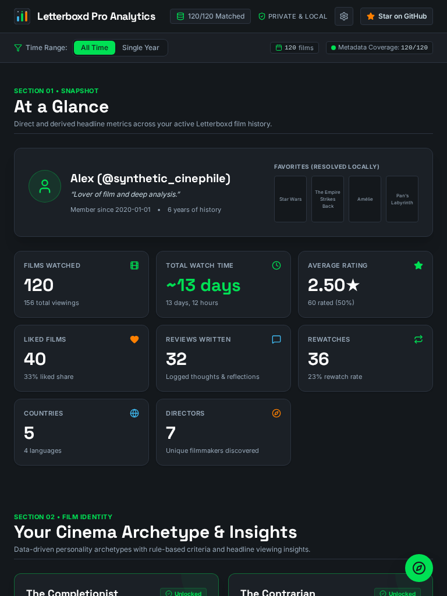

# Letterboxd Pro Analytics

<p align="center">
  
</p>

<p align="center">
  <a href="https://github.com/r-shafi/letterboxd-pro-analytics/actions"></a>
  <a href="LICENSE"></a>
  <a href="https://www.typescriptlang.org/"></a>
  <a href="docs/PRIVACY.md"></a>
  <a href="https://web.dev/progressive-web-apps/"></a>
</p>

A client-side Single Page Application and Progressive Web App (SPA + PWA) that transforms your official Letterboxd export into a **single, continuous scrolling narrative** of pro-level film analytics.

Everything happens **100% in your browser**. Your personal film export files never leave your device.

---

## Highlights & Features

- **Continuous Narrative Layout:** No fragmented tabs. All 14 analytical dimensions are laid out sequentially in an editorial, poster-forward bento grid.
- **Fast In-Browser Decompression:** Web Worker pipeline powered by `fflate` with multi-tier zip-bomb defense and `papaparse` multi-line CSV streaming.
- **TMDb Adaptive Enrichment:** Concurrency-controlled AIMD rate limiter (10–25 parallel workers) with exponential backoff on HTTP 429/5xx and fuzzy match scoring.
- **Bring Your Own Key (BYOK):** Seamless support for custom TMDb v3 API keys and v4 Read Access Tokens with client-side verification and zero server transmission.
- **One-Click Instant Demo:** Don't have your export archive handy? Click **"Try Demo Data"** to instantly explore all 14 sections with 120 synthetic film records.
- **100% Offline & Installable PWA:** Workbox-powered service worker caches app shell, web fonts, and poster assets for instant subsequent visits.
- **Share Card Generator:** Export high-resolution PNG summary cards in 1:1 Square (Instagram/Twitter) and 9:16 Story formats rendered entirely client-side via HTML Canvas.

---

## Responsive Design Across All Formats

Letterboxd Pro Analytics is mobile-first and scales across viewports:

| Desktop (1440x900) | Tablet Portrait (768x1024) | Mobile (390x844) |
| :---: | :---: | :---: |
|  |  |  |

---

## 14 Analytical Narrative Sections

1. **S1. Lifetime Snapshot:** Watch hours with exact coverage %, rated film share, rewatch velocity, and date-unknown disclosures.
2. **S2. Film Identity & Archetypes:** Rule-based personality badges (*The Cinephile Omnivore*, *Arthouse Devotee*, *Golden Era Classicist*, *Auteur Loyalist*).
3. **S3. Volume & Viewing Velocity:** Rata Die pure calendar arithmetic, active streaks, 365-day trailing activity heatmaps, and marathon screening days.
4. **S4. Ratings Distribution & Spread:** 10 half-step rating histogram, sample mean, median, mode, and standard deviation ($\sigma$).
5. **S5. The Crowd Contrarian:** Pearson correlation coefficient ($r$) against global TMDb ratings, quadrant scatter plot, biggest personal overrates and underrates.
6. **S6. Taste Profile & Bayesian Smoothing:** Grouped rating deltas shrunken via Bayesian shrinkage ($k=5$), Hipster Index (% popularity $< 15$), runtime sweet-spots, and normalized Shannon diversity entropy ($H$).
7. **S7. People & Filmmakers:** Circular portraits with rating chips for Directors, Lead Actors, Screenwriters, Cinematographers, Composers, and frequent creative pairings.
8. **S8. World Cinema & Language Geography:** ISO 3166-1 country frequency rankings and foreign language diversity breakdown.
9. **S9. Genres & Decades:** Decade volume breakdown ($1920\text{s} - 2020\text{s}$) and co-occurrence distributions.
10. **S10. Rewatches & Repeat Velocity:** Rewatch percentage, repeat velocity (average days between viewings), and most revisited titles.
11. **S11. Words, Reviews & Tags:** Stopword-pruned review vocabulary analysis, sentiment trends, and user tag distributions.
12. **S12. Watchlist Predictive Intelligence:** Machine-learning-inspired heuristic predicting ratings on unviewed watchlist films based on established director, genre, and actor affinities.
13. **S13. Superlatives & Quirks:** Extreme runtimes (longest/shortest), earliest/newest release years, and single-day logging records.
14. **S14. Social Share Card Generator:** Instant client-side PNG export in 1:1 and 9:16 aspect ratios.

For complete mathematical formulas and algorithms, see the [Analytics Catalog](docs/analytics-catalog.md).

---

## Tech Stack & Architecture

| Layer | Technology | Choice Justification |
| :--- | :--- | :--- |
| **Framework** | React 19 + Vite 6 | Maximum rendering performance, concurrent transitions, lightning HMR. |
| **Language** | TypeScript Strict 5.9 | Full compile-time type safety across all domain models and statistical functions. |
| **Styling** | Tailwind CSS v4 | Zero-runtime CSS variable design tokens matching Letterboxd's signature slate aesthetic. |
| **Animations** | Motion (`motion/react`) | Hardware-accelerated scroll reveals, layout reordering, and count-ups respecting `prefers-reduced-motion`. |
| **Charts** | Recharts 3 + D3 Modules | Declarative SVG visualization combined with low-level D3 math (`d3-array`, `d3-scale`, `d3-shape`). |
| **Parsing** | fflate + PapaParse | High-throughput, streaming unzipping with zip-bomb limits inside an isolated Web Worker. |
| **State & Cache** | Zustand + LZ-String + IndexedDB | Local-first state management with transparent LZ compression and quota overflow fallback to IndexedDB. |
| **PWA** | Vite-Plugin-PWA (Workbox) | Offline caching of application assets, web fonts, and remote TMDb poster artwork. |
| **Fonts** | Self-Hosted Fontsource (`Inter`, `Space Grotesk`) | Zero external Google Fonts requests for privacy, speed, and GDPR compliance. |

---

## How to Export Your Letterboxd Data

1. Log in to [letterboxd.com](https://letterboxd.com) on your computer or mobile browser.
2. Go to **Settings &rarr; Data &rarr; Export your data**.
3. A `.zip` archive will download (e.g. `letterboxd-username-2026-10-22.zip`).
4. Drag and drop the archive directly onto **Letterboxd Pro Analytics** (or select individual `.csv` files).

---

## Getting Started & Development

### Prerequisites
- Node.js $\ge 20.0.0$
- npm $\ge 10.0.0$

### Setup & Run
```bash
# Clone the repository
git clone https://github.com/r-shafi/letterboxd-pro-analytics.git
cd letterboxd-pro-analytics

# Install exact pinned dependencies
npm install

# Start development server
npm run dev

# Open in browser at http://localhost:5173
```

### Verification & Testing
```bash
# Run strict TypeScript compiler
npm run typecheck

# Run ESLint
npm run lint

# Run Vitest test suite (46 unit and integration tests)
npm run test

# Run production build
npm run build

# Verify dependency supply chain security
npm audit
```

---

## Configuration & Environment Variables

Copy `.env.example` to `.env`:

```bash
cp .env.example .env
```

| Variable | Description | Default |
| :--- | :--- | :--- |
| `VITE_SITE_NAME` | Display site name | `Letterboxd Pro Analytics` |
| `VITE_REPO_URL` | GitHub repository URL | `https://github.com/r-shafi/letterboxd-pro-analytics` |
| `VITE_AUTHOR_NAME` | Project author name | `R. Shafi` |
| `VITE_TMDB_FALLBACK_KEY` | Default TMDb v3 API key | Embedded fallback |
| `VITE_TMDB_API_BASE` | Optional reverse proxy base URL | `https://api.themoviedb.org/3` |
| `VITE_ANALYTICS_PROVIDER` | Usage telemetry provider (`plausible`, `umami`, `custom`) | `""` (Disabled by default) |

---

## Privacy & Zero-Knowledge Architecture

1. **Zero Server Storage:** No user data is ever uploaded to any database or backend server.
2. **Local Processing:** Files are decompressed and parsed entirely inside your browser's Web Worker.
3. **Sensitive Data Stripping:** Fields like `Email Address`, `Family Name`, `Pronoun`, `Location`, and `Website` are sanitized and discarded on import.
4. **TMDb Lookups:** Only public movie titles and release years are queried to TMDb for poster and credit enrichment.
5. **Telemetry Respect:** Anonymous aggregated metrics only (if enabled), strictly honoring `Do Not Track` (DNT) and in-app opt-out toggles.

For more details, read [PRIVACY.md](docs/PRIVACY.md).

---

## Legal & Disclaimers

- **The Movie Database (TMDb):** This product uses the TMDB API but is not endorsed or certified by TMDB. Film metadata, cast, crew, and artwork are provided courtesy of TMDb.
- **Letterboxd:** Not affiliated with, associated with, authorized by, endorsed by, or in any way officially connected with Letterboxd Limited or any of its subsidiaries or affiliates. All Letterboxd trademarks and logos belong to Letterboxd Limited.

---

## License

Released under the [MIT License](LICENSE). Copyright &copy; 2026 R. Shafi.
