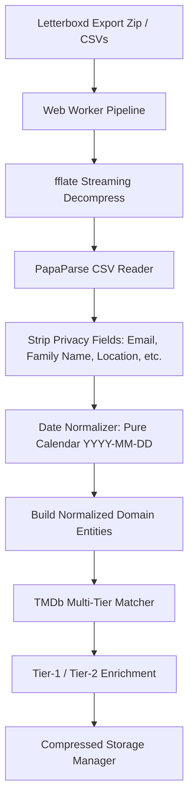

# System Architecture & Technical Specifications

## 1. Overview & Core Philosophy

**Letterboxd Pro Analytics** is an open-source, client-side Single Page Application (SPA) and Progressive Web App (PWA) for comprehensive film analytics from official Letterboxd data exports (`.zip` archive or extracted CSVs).

Key architectural tenets:
1. **Zero Server Footprint:** All parsing, matching, statistical computation, and local rendering occur entirely on the client. User film data (titles, viewings, ratings, diary logs, reviews, lists, watchlist) is never transmitted to any third-party server.
2. **Selective Metadata Enrichment:** Network requests are strictly limited to TMDb API endpoints for movie metadata, credits, release info, and poster images.
3. **Deterministic & Honest Statistics:** Every statistic shown displays exact sample size ($n$) and data coverage. No silent imputation or artificial rounding is permitted.
4. **Adaptive Concurrency & Resilient Ingestion:** Concurrency adapts dynamically to network health (AIMD algorithm), handling rate limits (HTTP 429) transparently without UI freeze.
5. **Instant Hydration & Offline Capable:** Processed data is stored in the browser with transparent IndexedDB spillover, enabling sub-second instant loads on return visits.

---

## 2. Tech Stack Decisions & Version Justifications

All dependencies use exact pinned versions published at least 14 days before October 22, 2026 (prior to October 8, 2026):

| Library | Pinned Version | Publish Date | Justification & Architectural Role |
| :--- | :--- | :--- | :--- |
| `react` & `react-dom` | `19.3.0` | 2026-09-09 | Latest stable React 19 release. First-class support for modern concurrent rendering, transitions, and hooks. |
| `typescript` | `7.0.2` | 2026-07-08 | Strict type checking with zero `any` casts. Guarantees sound data models from CSV parsing through analytics. |
| `vite` & `@vitejs/plugin-react` | `6.4.4` / `6.1.2` | 2026-10-06 / 2026-10-05 | Fast HMR, optimized production tree-shaking, code splitting, and Web Worker module bundling (`new Worker(new URL(...), { type: 'module' })`). |
| `tailwindcss` & `@tailwindcss/vite` | `4.3.3` | 2026-07-16 | Tailwind CSS v4 CSS-first configuration, native CSS variable tokens for dark slate theme, zero runtime overhead. |
| `motion` | `14.0.0` | 2026-10-02 | Motion React library (`motion/react`) for smooth reveals, layout shifts on reordering, animated counters, honoring `prefers-reduced-motion`. |
| `recharts` | `3.10.1` | 2026-07-25 | Standard bar, line, area, and scatter distributions. Fully responsive SVG chart rendering. |
| `d3-scale`, `d3-array`, `d3-shape`, `d3-geo`, `d3-hierarchy`, `d3-force` | `4.0.2`, `3.2.4`, `3.2.0`, `3.1.1`, `3.1.2`, `3.0.0` | 2021–2024 | Tree-shaken mathematical and geometric layout engines for custom visualizations: 365-day calendar heatmap, matrix grids, keyword bubble packs, actor network graphs, and world choropleth. |
| `world-atlas` & `topojson-client` | `2.0.2`, `3.1.0` | 2019 | Self-contained, lightweight 110m TopoJSON world geography dataset bundled locally without remote tile dependencies. |
| `fflate` | `0.7.5` | 2026-07-20 | Fastest lightweight ZIP decompression library in JavaScript. Supports stream decompression with zip-bomb limits (size and entry caps). |
| `papaparse` | `5.7.0` | 2026-08-24 | Battle-tested CSV parser capable of handling multi-line quoted reviews, uneven rows, UTF-8 BOM, and CRLF line breaks. |
| `comlink` | `4.4.2` | 2024-11-07 | Type-safe RPC abstraction over `postMessage` for offloading heavy parsing and number crunching to Web Workers. |
| `zustand` | `5.0.15` | 2026-08-13 | Minimal, non-intrusive reactive state management for UI filters, time range selection, progress states, and drawer drawers. |
| `idb-keyval` | `6.3.0` | 2026-07-08 | Promise-based IndexedDB key-value storage for transparent overflow when localStorage quota is exceeded. |
| `lz-string` | `1.5.0` | 2023-03-04 | High-speed compression for storing large datasets in browser storage. |
| `zod` | `4.6.5` | 2026-09-13 | Runtime validation at every input boundary (CSV inputs, TMDb payloads, localStorage schema migrations). |
| `vite-plugin-pwa` | `2.0.0` | 2026-10-03 | Workbox service worker generation, offline shell precaching, runtime TMDb image caching, and web app manifest. |
| `html-to-image` | `1.11.13` | 2025-02-14 | Client-side DOM-to-PNG rendering for social share cards (1:1 square and 9:16 vertical stories). |
| `lucide-react` | `1.52.0` | 2026-10-04 | Lightweight, consistent SVG icon set. |
| `@fontsource/inter`, `@fontsource/space-grotesk` | `5.3.0` | 2026-07-19 | Self-hosted typography: Inter for UI body, Space Grotesk for metrics and headings. Zero Google Fonts requests. |
| `vitest`, `@testing-library/react`, `jsdom` | `5.0.3`, `16.3.3`, `30.1.2` | 2026-08/10 | Strict test harness for unit, golden-value statistical, and component tests. |

---

## 3. TMDb API Specifications & Concurrency Architecture

### API Authentication & Key Formats
The app supports both authentication styles:
- **v3 API Key:** 32-character hexadecimal string passed via `?api_key=` query parameter.
- **v4 Read Access Token:** JWT Bearer token passed via `Authorization: Bearer <token>` header.
- **BYOK (Bring Your Own Key):** Users can enter their own TMDb API key or token in a settings modal. Key is verified via a lightweight `GET /authentication` or `GET /configuration` ping and stored in `localStorage`.
- **Fallback Key:** An optional preconfigured fallback key (`VITE_TMDB_FALLBACK_KEY`) is provided for instant zero-config exploration.

### Endpoints Used
1. `GET /configuration`: Fetches image base URLs and supported poster/backdrop dimensions (cached indefinitely).
2. `GET /search/movie?query={title}&year={year}&include_adult=false&language=en-US`: Primary matching endpoint.
3. `GET /movie/{id}?append_to_response=credits,keywords,release_dates,external_ids&language=en-US`: Comprehensive Tier-1 enrichment endpoint.
4. `GET /person/{id}`: Tier-2 enrichment for top 10 directors and actors (gender, birthday, birthplace).
5. `GET /person/{id}/movie_credits`: Tier-2 enrichment for filmography completionist calculation.
6. `GET /collection/{id}`: Tier-2 enrichment for franchise parts seen vs total.

### Concurrency Engine (AIMD)
TMDb enforces an IP rate limit of approximately 40–50 requests per second. To prevent 429 errors while maximizing throughput:
- **Additive Increase:** Initial concurrency starts at 10 requests. Concurrency increments by 1 for every 15 consecutive successful (HTTP 200) requests up to a hard ceiling of 25.
- **Multiplicative Decrease:** Upon receiving HTTP 429 or 5xx, concurrency is cut by 50% (floor 2). A global queue pause is initiated, honoring the `Retry-After` header if present, or using jittered exponential backoff ($500 \times 2^k + \text{jitter}$ ms, max 3 retries).
- **Deduplication:** A local match cache and in-flight promise pool prevents redundant network queries for identical titles or people.

### Required TMDb Attribution
- Display of the official TMDb logo in the footer and share cards.
- Mandatory legal notice: *"This product uses the TMDb API but is not endorsed or certified by TMDb."*

---

## 4. Ingestion & Domain Pipeline

### Domain Entities
- **Film (`Film`):** Letterboxd URI (unique identity key), title, release year, current user rating, watch status, liked flag, watchlist status, TMDb match status & metadata.
- **Diary Entry (`Entry`):** Unique entry ID, film key, watch date (`YYYY-MM-DD` or null with `isApproximate` flag), log date, entry rating, rewatch flag, user tags, review text.
- **List (`List`):** List slug, name, tags, description, ranked film items.
- **Profile (`Profile`):** Username, join date, bio, 4 favorite film keys (resolved locally from URI map). Excludes all private fields.

---

## 5. Statistical Methods & Formulas

1. **Duration Breakdown:**
   Total watch time computed as sum of known film runtimes multiplied by total viewings (rewatches counted). Formatted via `Intl.PluralRules` into compact (`~82 days`) and detailed (`2 months, 21 days, 20 hours`, assuming 1 month = 30 days).
2. **Bayesian Shrinkage Rating Affinity:**
   $$\bar{r}_{\text{shrunk}} = \frac{n \cdot \bar{r}_{\text{group}} + k \cdot \bar{r}_{\text{overall}}}{n + k} \quad (k = 5)$$
   Ranks groups fairly even when sample sizes vary significantly.
3. **Shannon Diversity Entropy (Normalized):**
   $$H_{\text{norm}} = -\frac{\sum_{i=1}^{K} p_i \ln p_i}{\ln K}$$
   Measures exploration and breadth across genres, countries, and languages over time.
4. **Contrarian & Generosity Indices:**
   - Contrarian Index: $\frac{1}{n} \sum_{i=1}^n |r_{i, \text{user}} - r_{i, \text{tmdb\_norm}}|$
   - Generosity Index: $\frac{1}{n} \sum_{i=1}^n (r_{i, \text{user}} - r_{i, \text{tmdb\_norm}})$
   - Only calculated for films with $\ge 100$ TMDb votes.
5. **Watchlist Rating Prediction Model:**
   Weighted blend of shrunken taste affinities across genres (weight 0.40), directors (weight 0.25), decades (weight 0.15), countries (weight 0.10), and keywords (weight 0.10) combined with TMDb crowd baseline. Backtested using leave-one-out cross validation with Mean Absolute Error (MAE) displayed to the user.

---

## 6. Telemetry & Privacy Architecture

- **Strict Allowlist:** Telemetry adapter triggers only predefined events: `app_loaded`, `import_started`, `import_completed`, `import_failed`, `enrichment_completed`, `section_viewed`, `share_card_generated`, `byok_enabled`, `pwa_installed`, `github_cta_click`.
- **Zero Content Leakage:** Telemetry properties never include movie titles, usernames, ratings, tags, review text, or filenames. Only aggregate buckets (e.g. `film_count_bucket: "1000-2500"`) are permitted.
- **Cookieless & DNT-Compliant:** Respects `navigator.doNotTrack` and `navigator.globalPrivacyControl`. User toggle provided in settings.
